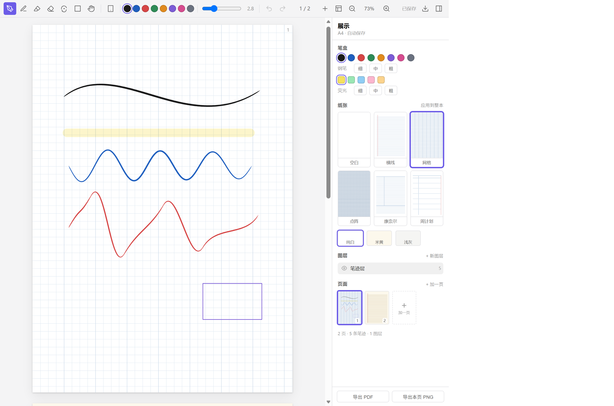
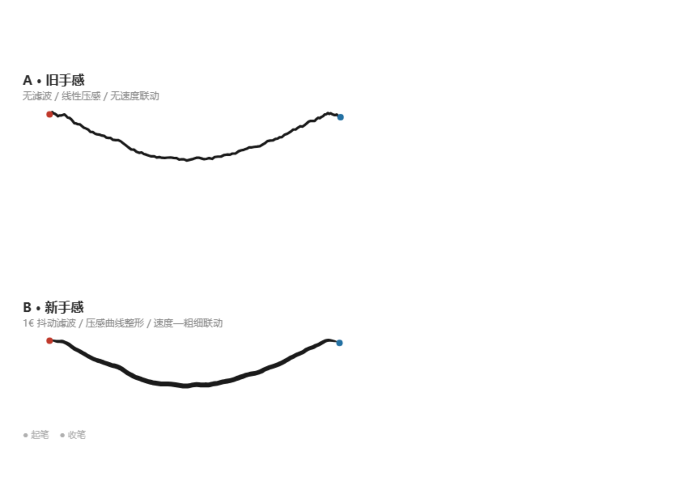

# 墨本 Inkbook

Obsidian 里的 A4 手写笔记本。手写内核是重新写的，不是套壳。



---

## 为什么单独做一个

之前的想法是把《享做笔记 Notein》（`base.apk`）的手写形式搬进 Obsidian。拆开看过之后结论很清楚：

- APK 里的手写、OCR、公式识别全是 Android 原生库（`libinkkit_ocr`、`liblatex_ocr_jni`、ONNX 模型），Obsidian 插件跑在 TypeScript + Electron/WebView 里，**一个都用不了**；
- 但它的**交互形式**完全可以用 Web 技术重写，而且重写之后能比原生 App 更适合 Obsidian——笔迹直接存在库里，跟着 Sync 走。

所以墨本是用 Canvas + PointerEvent 从零写的，重点放在**手写手感**上。

---

## 手写手感做了哪些事

这是墨本和"能画线的 canvas"之间最大的差别。四层处理：

### 1. 1€ 抖动滤波（`src/filter.ts`）

手抖和数位笔采样噪声会直接变成线条上的毛刺。用 1€ 滤波器（Casiez et al. 2012）按速度动态调节截止频率：写得慢滤得狠（去抖），写得快滤得轻（不拖尾）。

普通低通滤波会把快笔也抹平，导致"跟手性"下降；1€ 滤波没有这个问题。

### 2. 压感曲线整形

原始设备压力是线性且下限很低的，直接用会出现两种难看的效果：轻碰几乎没线、重按糊成一团。整形做了三件事：

- 抬底噪：低于阈值直接判为没按；
- 提亮段：让轻到中等压力的区分度更高（这一段是人最敏感的）；
- 压上限：重按时趋于饱和，不会无限变粗。

### 3. 入锋 / 出锋包络（`src/ink.ts`）

真笔迹一定是**两头细、中间粗**。`envelopePressures()` 沿弧长把压力做成"轻→重→轻"的包络：

```
起笔 0.28  →  行笔 0.70  →  收笔 0.27
```

这条曲线有实测数据支撑（见下方"手感验证"）。没有数位笔时也照样成立——鼠标没压力，但包络照样让笔画有"写"的味道。

### 4. 速度—粗细联动 + 笔画预测

- **速度联动**：写得快的地方笔画自然收窄，避免飞白成一团。
- **笔画预测**（`predictTail()`）：根据最近几点的速度与加速度外推一小段，让墨迹**跑在笔尖前面**。Apple Notes / GoodNotes 都有这一层，落笔的跟手感立刻不一样。可以关。



上图 A 是旧管线（无滤波 / 线性压感 / 无速度联动），B 是墨本的管线。同一条带抖动的轨迹，差别一眼可见。

---

## 功能

**纸与页**
- A4 纵向连续滚动，写满往下接着写
- 6 种纸张模板：空白 / 横线 / 网格 / 点阵 / 康奈尔 / 周计划
- 3 种纸色：纯白 / 米黄 / 浅灰
- 页面缩略图、加页、复制页、删页、跳页

**笔**
- 钢笔（压感笔锋）、圆珠笔、荧光笔（正片叠底，压得住字）
- 整笔橡皮 / 局部橡皮（局部擦会把一条笔迹切断）
- 形状：矩形 / 椭圆 / 直线 / 箭头（按住 Shift 吸附角度与正方形）
- 套索：圈选、拖动移动、Delete 删除

**组织**
- 多图层，可隐藏、重命名、删除
- 撤销 / 重做（跨页也能撤）
- 1 秒自动保存

**导出**
- 整本 PDF
- 当前页 PNG（2 倍分辨率）

---

## 快捷键

| 键 | 作用 |
| --- | --- |
| `P` | 钢笔 |
| `B` | 圆珠笔 |
| `H` | 荧光笔 |
| `E` | 橡皮 |
| `L` | 套索 |
| `R` | 形状 |
| `T` | 只认触控笔（手指只滚动，掌根不落笔） |
| `Ctrl+Z` / `Ctrl+Shift+Z` | 撤销 / 重做 |
| `Ctrl+S` | 立即保存 |
| `0` | 整页适应窗口 |
| `+` / `-` | 放大 / 缩小 |
| `Delete` | 删除选中笔迹 |
| `Esc` | 取消选择 |

---

## 设置

Obsidian → 设置 → 墨本 Inkbook：

| 设置 | 说明 |
| --- | --- |
| 新建时的纸张模板 / 纸色 | 只影响新建的本子 |
| 默认笔尖粗细 | 页面坐标里的粗细 |
| 压感灵敏度 | 越大，轻写与重写的粗细差别越明显（0.3–1.5） |
| **手写平滑** | 滤掉手抖。调高更稳，调低更跟手（0–1） |
| **笔画预测** | 墨迹跑在笔尖前面，类似 Apple Notes |
| 只认触控笔 | 手指只负责滚动 |
| 自动保存 | 停笔约 0.8 秒写回文件 |

---

## 文件格式

`.inkbook` 就是库里的普通 JSON 文件，放进你指定的文件夹，Obsidian Sync / 网盘都能同步。

```jsonc
{
  "version": 1,
  "kind": "inkbook",
  "title": "我的笔记",
  "width": 794,          // A4 宽（页面坐标）
  "height": 1123,        // A4 高
  "activePage": 0,
  "pages": [
    {
      "id": "page_...",
      "template": "grid",
      "paper": "white",
      "activeLayerId": "layer_...",
      "layers": [
        {
          "id": "layer_...",
          "name": "笔迹层",
          "visible": true,
          "opacity": 1,
          "strokes": [
            {
              "id": "stroke_...",
              "tool": "pen",        // pen | ballpoint | highlighter | shape
              "color": "#1A1A1A",
              "size": 2.8,
              "opacity": 1,
              "points": [[x, y, pressure], ...]   // 压力 0–1
            }
          ]
        }
      ]
    }
  ]
}
```

笔迹只存**采样点 + 压力**，笔锋和粗细在渲染时算出来——所以文件很小，改笔尖样式也不用重写数据。

---

## 开发

```bash
npm install
npm run typecheck     # tsc --noEmit
npm run build         # 产出 dist/inkbook/
npm run demo          # 浏览器手感预览（先 npm run demo 之外的 server）
```

### 目录

```
src/main.ts        插件入口：注册视图、命令、设置面板
src/editor.ts      画布引擎：指针事件、图层、页面、撤销
src/ink.ts         笔迹渲染：perfect-freehand + 入锋出锋包络 + 笔画预测
src/filter.ts      1€ 抖动滤波、压感整形、速度—粗细联动
src/paper.ts       纸张模板与纸色
src/store.ts       数据模型与撤销栈
src/storage.ts     .inkbook 读写
src/export.ts      PNG / PDF 导出
src/view.ts        Obsidian 视图：工具栏、侧栏、快捷键
src/settings.ts    设置面板
src/modals.ts      新建本子 / 跳页 / 重命名弹窗
```

### 浏览器预览

同一套引擎可以直接在浏览器里跑，用来快速试手感（不用每次重启 Obsidian）：

```bash
node test/server.mjs        # http://127.0.0.1:8901
```

- `/` — 手感预览页
- `/compare.html` — 新旧手感对比
- `/e2e.html` — 鼠标模拟手写

### 自动化测试

无头 Edge 驱动真实浏览器，覆盖 105 项：

```bash
node test/run.mjs http://127.0.0.1:8901/test.html     # 手写内核 35 项
node test/run.mjs http://127.0.0.1:8901/feel.html     # 手感算法 20 项
node test/run.mjs http://127.0.0.1:8901/view.html     # Obsidian 视图 28 项
node test/run.mjs http://127.0.0.1:8901/plugin.html   # 插件入口 7 项
node test/run.mjs http://127.0.0.1:8901/dist.html     # 构建产物 15 项
```

其中 `dist.html` 最关键：**它加载的是 `dist/inkbook/main.js`（压缩后的真实交付文件）**，
用 Obsidian 真实的加载方式（`window.eval("(function anonymous(require,module,exports){...})")`）
执行，完整走通「注册视图 → 打开 .inkbook → 渲染界面 → 落笔 → 自动保存写回」。

所以测的不是源码，是用户真正会装到 Obsidian 里的那个文件。

---

## 手感验证

手感不能靠"我觉得还行"，得有数字。`test/feel-diag.ts` 用真实 PointerEvent 走一遍落笔，统计最终生效的压力曲线：

```
采样点 78
压力 min=0.266 max=0.792 avg=0.676
起笔 5 点: 0.28 0.29 0.32 0.39 0.48
中段 5 点: 0.69 0.69 0.70 0.70 0.70
收笔 5 点: 0.46 0.38 0.32 0.28 0.27
动态范围 max/min = 2.98
起笔 < 中段 : 成立
收笔 < 中段 : 成立
```

改这套参数之前动态范围只有 1.28（起收笔反而最粗），现在是 2.98——这才是真笔迹的形状。

---

## 还没做的

- **手写转文字 / 公式识别**：APK 里是本机 OCR 模型，Web 端要接外部服务，不适合直接照搬
- **无界画布**：现在是 A4 连续页，无界是另一套坐标模型
- **PDF 当底图**：可以复用砚的 PDF 引擎，但属于另一种文档形态
- **倾斜笔尖 / 双笔尖**：需要设备倾斜角支持

---

## 许可

MIT
